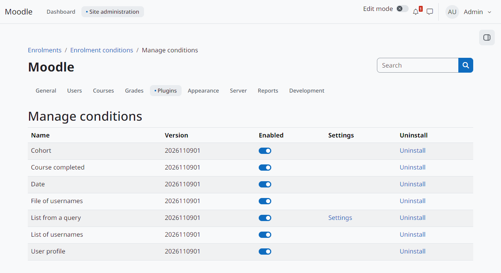
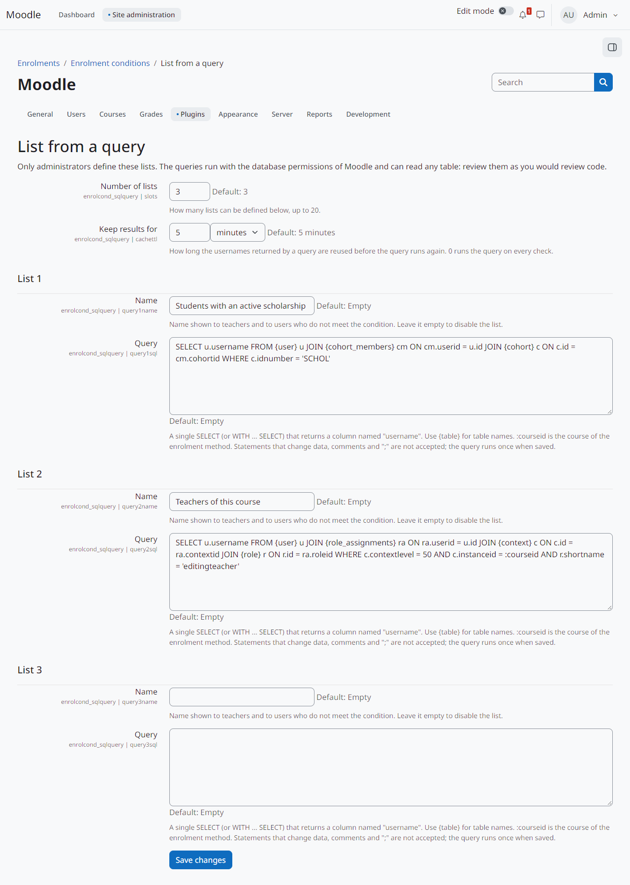

Administration
==============

Managing the condition types
----------------------------

*Site administration > Plugins > Enrolments > Enrolment conditions > Manage conditions* lists the installed condition types, with their version, an *Enabled* switch, a link to their settings (when they have any) and *Uninstall*.

   The installed condition types.

A disabled type is no longer offered to teachers. Enrolment methods that already use it keep it in their trees, but the condition can no longer be checked: its result is *unknown*. ``enrol_conditional`` then refuses new self enrolments and never suspends, removes or reactivates anybody because of it.

Lists from a query
------------------

The *List from a query* condition only offers the lists that an administrator defines in its settings (*Manage conditions*, then *Settings* of *List from a query*):

Number of lists
   How many lists can be defined (default 3, at most 20).

Keep results for
   How long the usernames returned by a query are reused before it runs again (default 5 minutes; 0 runs it on every check).

Name and Query
   For each list. The name is shown to teachers and to users who do not meet the condition; an empty name disables the list. The query is a single ``SELECT`` (or ``WITH ... SELECT``) that returns a column named ``username``. Use ``{table}`` for table names; ``:courseid`` is the course of the enrolment method.

   Two lists defined by the administrator.

When the settings are saved, each query is checked and run once. Queries with ``;``, comments, statements that change data, ``INTO`` or functions that wait or read server files are refused.

.. warning::
   The queries run with the database permissions of Moodle and can read any table, including passwords and personal data. The checks catch common mistakes, not a malicious administrator. Review each query as you would review code.

Example, the users with a given institution:

.. code-block:: text

   SELECT username FROM {user} WHERE institution = 'IFRN' AND deleted = 0

Scheduled task
--------------

*Delete files of usernames no longer used by any condition* (``enrolcond_userfile``) runs daily and deletes, after one day, the files that no condition uses any more.
