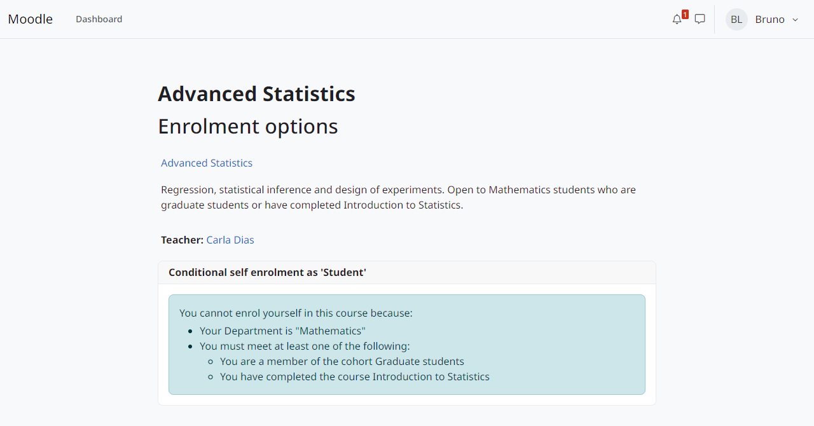

Conditions
==========

The condition tree
------------------

The conditions of an enrolment method form a tree whose root is a group:

* A group requires *all* of its items (AND) or *any* of them (OR).
* Groups can be nested, up to 5 levels and 100 items in total.
* Any condition or group can be marked *Must not be met* (NOT).
* A tree without conditions is always met.

Each condition is met, not met or **unknown**. A condition is unknown when it cannot be checked: its type was disabled or uninstalled, its file was lost or its query failed. Unknown values combine as follows: AND is not met if any item is not met, otherwise unknown if any item is unknown; OR is met if any item is met, otherwise unknown if any item is unknown; NOT keeps unknown as unknown.

The plugin that uses the tree decides what unknown means. ``enrol_conditional`` refuses new self enrolments and takes no action on existing ones.

Users who do not meet the tree see which conditions are missing, including the groups (*You must meet at least one of the following:*).

   The explanation shown by ``enrol_conditional``.

Condition types
---------------

Date (``enrolcond_date``)
   Met from a date and time (*From*), until a date and time (*Until*) or between both.

   .. image:: ../img/condition-date.png
      :alt: Date condition dialog.
      :width: 520px

User profile (``enrolcond_profile``)
   Compares a standard or custom profile field with a value: *is equal to*, *contains*, *does not contain*, *starts with*, *ends with*, *is empty* or *is not empty*. Case is ignored. Observes the update of the user profile.

   .. image:: ../img/condition-profile.png
      :alt: User profile condition dialog.
      :width: 520px

Cohort (``enrolcond_cohort``)
   Met by the members of a cohort available in the course context. Observes members added to or removed from a cohort. Restored on another site, the condition no longer points to a cohort and is not met until a teacher edits it.

   .. image:: ../img/condition-cohort.png
      :alt: Cohort condition dialog.
      :width: 520px

Course completed (``enrolcond_coursecompleted``)
   Met by the users who completed another course. Observes course completion. Restored on another site, it is not met until a teacher edits it.

   .. image:: ../img/condition-coursecompleted.png
      :alt: Course completed condition dialog.
      :width: 520px

List of usernames (``enrolcond_userlist``)
   Usernames typed in the condition, one per line or separated by spaces, commas or semicolons; case is ignored. At most 5,000 usernames.

   .. image:: ../img/condition-userlist.png
      :alt: List of usernames condition dialog.
      :width: 520px

File of usernames (``enrolcond_userfile``)
   A CSV or text file with the usernames in the first column (a first line ``username`` is a header). The file is kept in the course and goes in its backups; the teacher replaces it to update the list. At most 200,000 usernames. If the file is lost, the condition is unknown.

   .. image:: ../img/condition-userfile.png
      :alt: File of usernames condition dialog.
      :width: 520px

List from a query (``enrolcond_sqlquery``)
   One of the lists defined by an administrator (see :doc:`administration`). Teachers choose a list by its name and never see the query. The result is cached; a query that fails is unknown. Inside an open database transaction the query is not run: without a cached result the condition is unknown until it is checked outside one.

   .. image:: ../img/condition-sqlquery.png
      :alt: List from a query condition dialog.
      :width: 520px

Date, usernames and query conditions observe no event: they change with time or with data outside the course. ``enrol_conditional`` checks them again at login or periodically, when the enrolment method is set to do so.

Conditions from other plugins
-----------------------------

Other plugins can add condition types; they appear in the editor next to these. See :doc:`developers`.
