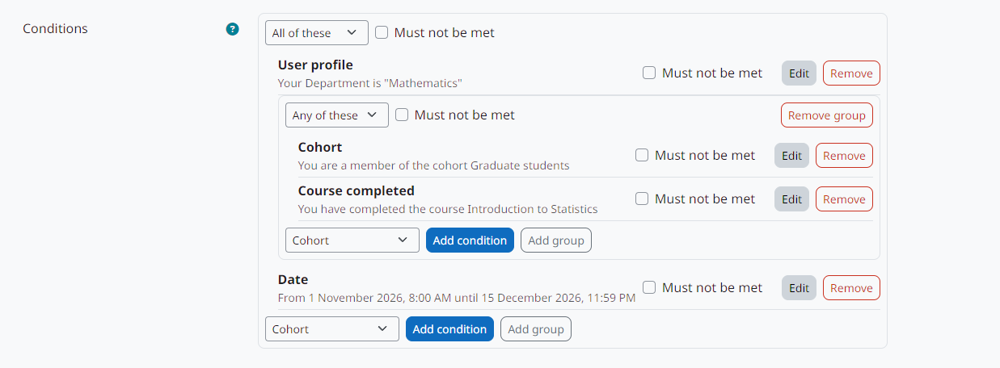

moodle-local_enrolconditions
============================

**Condition engine for conditional self enrolment in Moodle: dates, profile fields, cohorts, completed courses and lists of usernames, combined with AND, OR and NOT.**

Versão em português: `Português (Brasil) <../pt-br/index.html>`_.

*Enrolment conditions* is the condition engine of the `Conditional self enrolment <https://moodle-by-kelsoncm.github.io/enrol_conditional/>`_ method (``enrol_conditional``). It has no page for teachers: the conditions are built in the settings of the enrolment method, and this plugin evaluates them.

   Conditions of an enrolment method, built with the editor of this plugin.

What it provides
----------------

* The ``enrolcond`` subplugin type (folder ``condition/``) and seven condition types: date, user profile field, cohort, course completed, list of usernames, file of usernames and lists defined by the administrator as database queries.
* A tree of conditions: groups that require *all* or *any* of their items, nested up to 5 levels, with any item marked as *must not be met*.
* A three-valued evaluation (met, not met, unknown) and the explanation shown to users who do not meet the conditions.
* The condition editor and the configuration dialogs used in the enrolment method form.
* The base class ``\local_enrolconditions\condition\base`` and the hook ``\local_enrolconditions\hook\collect_conditions``, so other plugins can add their own conditions.
* A page to enable, disable and uninstall the condition types.

Requires Moodle 5.3 LTS. Install it together with ``enrol_conditional``.

.. toctree::
   :maxdepth: 2
   :caption: Contents

   installation
   administration
   conditions
   developers
   privacy
