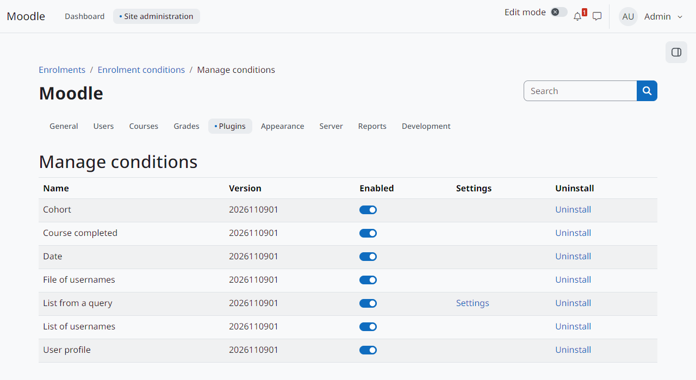
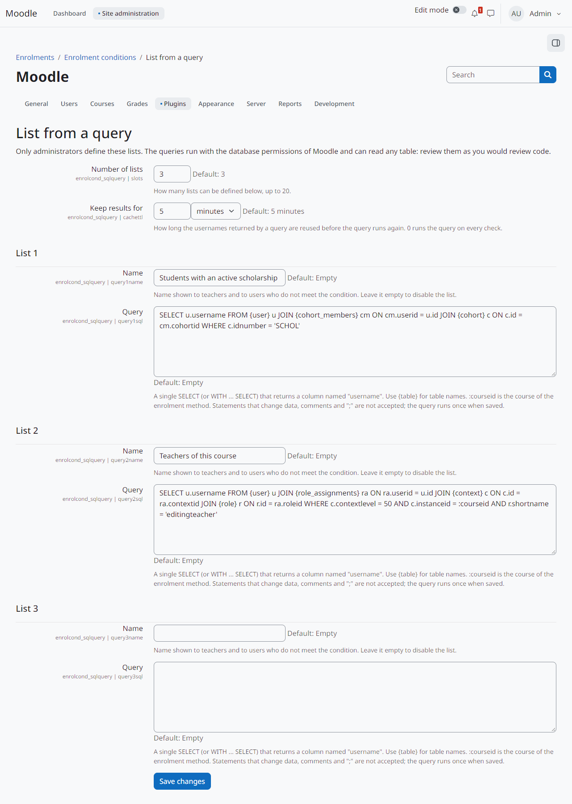

Administração
=============

Gerenciando os tipos de condição
--------------------------------

*Administração do site > Plugins > Inscrições > Enrolment conditions > Manage conditions* lista os tipos de condição instalados, com a versão, a chave *Enabled* (habilitado), o link para as configurações (quando houver) e *Uninstall* (desinstalar).

   Os tipos de condição instalados.

Um tipo desabilitado deixa de ser oferecido aos professores. Os métodos de inscrição que já o usam mantêm a condição na árvore, mas ela não pode mais ser avaliada: o resultado é *desconhecido*. O ``enrol_conditional`` então recusa novas autoinscrições e nunca suspende, remove ou reativa ninguém por causa dela.

Listas de consulta
------------------

A condição *List from a query* só oferece as listas que um administrador definiu nas configurações dela (*Manage conditions* e depois *Settings* de *List from a query*):

Number of lists
   Quantas listas podem ser definidas (padrão 3, no máximo 20).

Keep results for
   Por quanto tempo os usernames devolvidos por uma consulta são reaproveitados antes de ela rodar de novo (padrão 5 minutos; 0 roda a cada avaliação).

Name e Query
   Para cada lista. O nome aparece para os professores e para os usuários que não cumprem a condição; nome vazio desabilita a lista. A consulta é um único ``SELECT`` (ou ``WITH ... SELECT``) que devolve uma coluna chamada ``username``. Use ``{tabela}`` nos nomes de tabela; ``:courseid`` é o curso do método de inscrição.

   Duas listas definidas pelo administrador.

Ao salvar as configurações, cada consulta é verificada e executada uma vez. São recusadas consultas com ``;``, comentários, comandos que alteram dados, ``INTO`` ou funções de espera e de leitura de arquivos do servidor.

.. warning::
   As consultas rodam com as permissões de banco do Moodle e podem ler qualquer tabela, inclusive senhas e dados pessoais. As verificações pegam erros comuns, não um administrador mal-intencionado. Revise cada consulta como se fosse código.

Exemplo, os usuários de uma instituição:

.. code-block:: text

   SELECT username FROM {user} WHERE institution = 'IFRN' AND deleted = 0

Tarefa agendada
---------------

*Delete files of usernames no longer used by any condition* (``enrolcond_userfile``) roda diariamente e apaga, depois de um dia, os arquivos que nenhuma condição usa mais.
