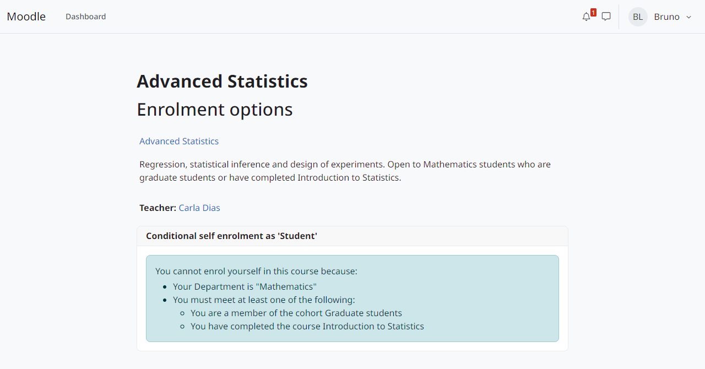

Condições
=========

A árvore de condições
---------------------

As condições de um método de inscrição formam uma árvore cuja raiz é um grupo:

* Um grupo exige *todos* os itens (E) ou *qualquer um* deles (OU).
* Grupos podem ser aninhados, em até 5 níveis e 100 itens no total.
* Qualquer condição ou grupo pode ser marcado *Must not be met* (NÃO).
* Uma árvore sem condições é sempre cumprida.

Cada condição é cumprida, não cumprida ou **desconhecida**. Uma condição é desconhecida quando não pode ser avaliada: o tipo foi desabilitado ou desinstalado, o arquivo se perdeu ou a consulta falhou. Os valores desconhecidos se combinam assim: E não é cumprido se algum item não é cumprido, senão é desconhecido se algum item é desconhecido; OU é cumprido se algum item é cumprido, senão é desconhecido se algum item é desconhecido; NÃO mantém o desconhecido como desconhecido.

O plugin que usa a árvore decide o que fazer com o desconhecido. O ``enrol_conditional`` recusa novas autoinscrições e não mexe nas inscrições existentes.

Quem não cumpre a árvore vê quais condições faltam, inclusive os grupos (*You must meet at least one of the following:*).

   A explicação mostrada pelo ``enrol_conditional``.

Tipos de condição
-----------------

Data (``enrolcond_date``)
   Cumprida a partir de uma data e hora (*From*), até uma data e hora (*Until*) ou entre as duas.

   .. image:: ../img/condition-date.png
      :alt: Janela da condição de data.
      :width: 520px

Perfil do usuário (``enrolcond_profile``)
   Compara um campo de perfil padrão ou personalizado com um valor: *is equal to*, *contains*, *does not contain*, *starts with*, *ends with*, *is empty* ou *is not empty*. Maiúsculas e minúsculas contam igual. Observa a atualização do perfil do usuário.

   .. image:: ../img/condition-profile.png
      :alt: Janela da condição de perfil.
      :width: 520px

Coorte (``enrolcond_cohort``)
   Cumprida pelos membros de uma coorte disponível no contexto do curso. Observa a entrada e a saída de membros de coortes. Restaurada em outro site, a condição deixa de apontar para uma coorte e não é cumprida até um professor editá-la.

   .. image:: ../img/condition-cohort.png
      :alt: Janela da condição de coorte.
      :width: 520px

Curso concluído (``enrolcond_coursecompleted``)
   Cumprida por quem concluiu outro curso. Observa a conclusão de cursos. Restaurada em outro site, não é cumprida até um professor editá-la.

   .. image:: ../img/condition-coursecompleted.png
      :alt: Janela da condição de curso concluído.
      :width: 520px

Lista de usernames (``enrolcond_userlist``)
   Usernames digitados na condição, um por linha ou separados por espaço, vírgula ou ponto e vírgula; maiúsculas e minúsculas contam igual. No máximo 5.000 usernames.

   .. image:: ../img/condition-userlist.png
      :alt: Janela da condição de lista de usernames.
      :width: 520px

Arquivo de usernames (``enrolcond_userfile``)
   Um arquivo CSV ou texto com os usernames na primeira coluna (uma primeira linha ``username`` é tratada como cabeçalho). O arquivo fica guardado no curso e vai nos backups dele; o professor o substitui para atualizar a lista. No máximo 200.000 usernames. Se o arquivo se perder, a condição fica desconhecida.

   .. image:: ../img/condition-userfile.png
      :alt: Janela da condição de arquivo de usernames.
      :width: 520px

Lista de consulta (``enrolcond_sqlquery``)
   Uma das listas definidas por um administrador (veja :doc:`administration`). O professor escolhe a lista pelo nome e nunca vê a consulta. O resultado fica em cache; uma consulta com erro é desconhecida. Dentro de uma transação de banco aberta a consulta não roda: sem resultado em cache, a condição fica desconhecida até ser avaliada fora de uma.

   .. image:: ../img/condition-sqlquery.png
      :alt: Janela da condição de lista de consulta.
      :width: 520px

As condições de data, de usernames e de consulta não observam eventos: mudam com o tempo ou com dados de fora do curso. O ``enrol_conditional`` as reavalia no login ou periodicamente, quando o método de inscrição está configurado para isso.

Condições de outros plugins
---------------------------

Outros plugins podem acrescentar tipos de condição, que aparecem no editor ao lado destes. Veja :doc:`developers`.
