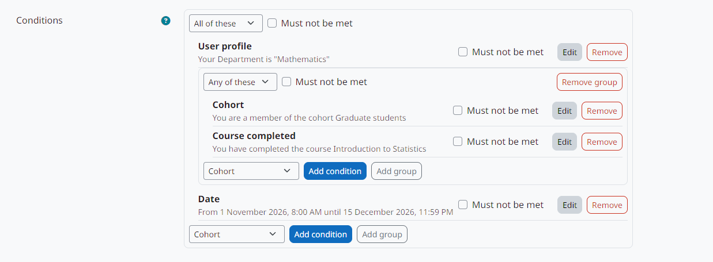

moodle-local_enrolconditions
============================

**Motor de condições da autoinscrição condicional do Moodle: datas, campos de perfil, coortes, cursos concluídos e listas de usernames, combinados com E, OU e NÃO.**

English version: `English <../en/index.html>`_.

O *Enrolment conditions* é o motor de condições do método `Conditional self enrolment <https://moodle-by-kelsoncm.github.io/enrol_conditional/>`_ (``enrol_conditional``). Ele não tem página para o professor: as condições são montadas nas configurações do método de inscrição, e este plugin as avalia.

   Condições de um método de inscrição, montadas com o editor deste plugin.

O que ele oferece
-----------------

* O tipo de subplugin ``enrolcond`` (pasta ``condition/``) e sete tipos de condição: data, campo do perfil, coorte, curso concluído, lista de usernames, arquivo de usernames e listas definidas pelo administrador como consultas ao banco.
* Uma árvore de condições: grupos que exigem *todos* ou *qualquer um* dos itens, aninhados em até 5 níveis, com qualquer item marcado como *não deve ser cumprida*.
* Avaliação com três valores (cumprida, não cumprida, desconhecida) e a explicação mostrada a quem não cumpre as condições.
* O editor de condições e as janelas de configuração usados no formulário do método de inscrição.
* A classe base ``\local_enrolconditions\condition\base`` e o hook ``\local_enrolconditions\hook\collect_conditions``, para que outros plugins acrescentem condições próprias.
* Uma página para habilitar, desabilitar e desinstalar os tipos de condição.

Requer Moodle 5.3 LTS. Instale junto com o ``enrol_conditional``.

.. note:: O plugin só traz o pacote de idioma em inglês; os nomes da interface aparecem aqui em inglês, como no Moodle sem tradução.

.. toctree::
   :maxdepth: 2
   :caption: Conteúdo

   installation
   administration
   conditions
   developers
   privacy
